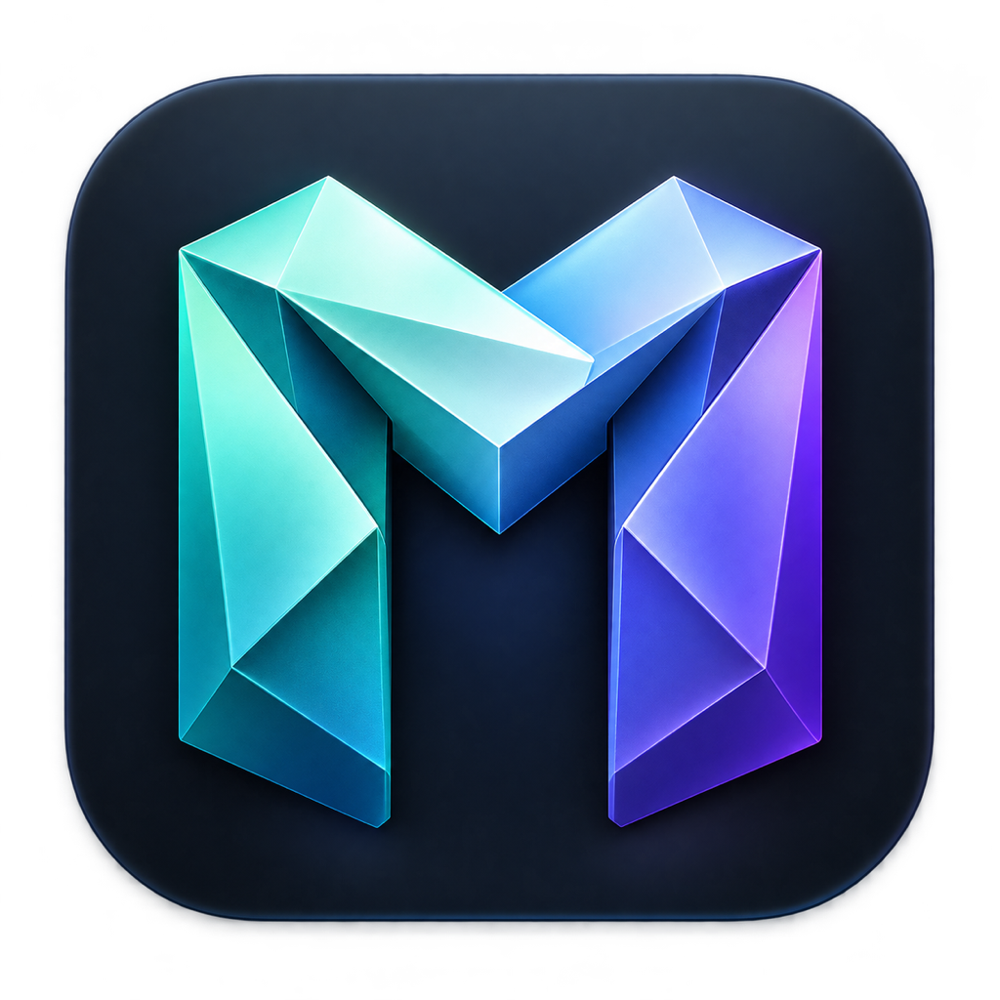
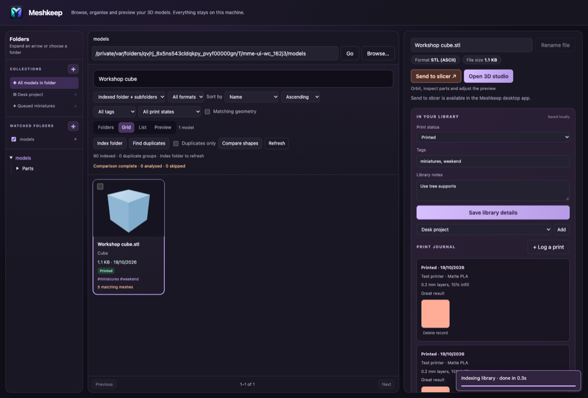

<p align="center">
  
</p>

# Meshkeep

**Your 3D model collection, organised.**

Meshkeep brings your downloaded models, personal designs and print projects into one local library. Browse folders, preview models in 3D, organise collections and keep track of what you want to print next.

Your models stay in their original folders. Tags, collections and print records are stored locally, with no account or cloud upload required.



## Features

- **Browse your library:** folder tree, grid, list and preview views, with search, filters and sorting.
- **Organise without moving files:** tags, library notes, hand-picked collections and smart collections based on rules.
- **Build multipart projects:** group model files into projects, set required quantities, track printed copies and assembly status, and keep notes for each part.
- **Track your prints:** Want to print, Printed and Needs another attempt, plus a print journal with printer, material, settings, notes and photos.
- **Watch folders:** automatically index additions and changes in selected folders while Meshkeep is open.
- **Preview in 3D:** orbit, pan, zoom, lighting presets, materials, exposure, wireframe, part picking and isolation.
- **See painted 3MF colours:** Bambu/Orca filament palettes and painted regions, including subdivided colour boundaries.
- **Inspect models:** dimensions, triangle counts, estimated solid volume and point-to-point measurements.
- **Find duplicates:** exact content hashes and geometry matching, including renamed copies.
- **Send to your slicer:** open selected models in your chosen slicer from the Mac or Windows desktop app.
- **Edit metadata:** update supported names, authorship and other metadata; add a custom 3MF cover image.

## Supported formats and platforms

Meshkeep browses and previews **3MF, STL, OBJ, PLY and AMF** files. Metadata fields and editing support vary by format.

Meshkeep supports desktop apps for **Apple Silicon Macs** and **Windows x64**. The current source version is **2.0.5**, which adds multipart projects with quantities, print progress, assembly status and part notes. GitHub release checks and in-app updates were introduced in 2.0.4. Preview limits remain 250 MiB per model and 500 MiB unpacked for 3MF.

## Install on Windows

Download `Meshkeep-2.0.5-Windows-x64-Setup.exe` from the [**Releases**](https://github.com/SUP3RMASS1VE/Meshkeep/releases) page when available, then open it and follow the installer.
It installs for your Windows account and creates Start menu and desktop shortcuts.
The app bundles Python and Electron; Python and Node.js are not needed to use it.
This build is unsigned, so Windows may show an unknown-publisher warning.

## Install on Mac

1. Download the Apple Silicon `.dmg` from the [**Releases**](https://github.com/SUP3RMASS1VE/Meshkeep/releases) page when a release is available.
2. Open the `.dmg` and drag **Meshkeep** into **Applications**.
3. Open **Meshkeep** from Applications.

The packaged app includes its runtime. You do not need to install Python or Node.js to use it.

### First launch: macOS Gatekeeper

**Mac builds produced without the signing secrets are not Developer ID signed or notarised by Apple.** macOS Gatekeeper may block it on first launch because Apple cannot verify its developer.

If you trust the download and want to open it:

1. Try opening **Meshkeep** once so macOS records the blocked attempt, then dismiss the alert.
2. Open **Apple menu → System Settings → Privacy & Security**.
3. Scroll down to the **Security** section. If **Allow applications from** (or **Allow apps downloaded from**, depending on your macOS version) is set to **App Store** only, choose **App Store and identified developers**.
4. Find the message saying Meshkeep was blocked and click **Open Anyway**.
5. Authenticate if prompted, then click **Open** to confirm.

Selecting **App Store and identified developers** alone does not approve this unsigned build: use **Open Anyway** for Meshkeep. macOS saves that app-specific exception for later launches. You do not need to disable Gatekeeper or enable applications from anywhere.

Only approve a download you trust. These steps are for an unidentified-developer or unnotarised-app warning; they are not a workaround for an alert saying an app contains malware or is damaged. On a managed Mac, your administrator may restrict these options.

See [Apple's guide to opening apps safely](https://support.apple.com/en-gb/102445) for the official instructions.

## App updates

The installed app checks public GitHub Releases when it opens. A newer stable release appears in a banner. Choose **Download update**, keep working while it downloads, then choose **Restart and install** when ready. **Later** dismisses the notice; **Check for updates** in the header or app menu brings it back. Network failures during the startup check do not interrupt your work.

Windows supports downloading and installing from the app. Mac in-app installation requires a Developer ID signed build; unsigned Mac builds check for updates and offer **View release** for manual installation. Signing support is included in the build workflow. See [auto-update setup](docs/auto-updates.md) for the signing secrets, required release assets and end-to-end verification.

Users of 2.0.3 or earlier need to install 2.0.4 manually once. Unsigned Mac users must also manually install the first signed version before they can receive signed in-app updates.

## Getting started

1. Choose a folder containing your models.
2. Select **Index folder** to catalogue it and its subfolders, then search or filter your library.
3. Open a model to edit supported metadata, add tags or record its print status.
4. Choose **Open 3D studio** to inspect the geometry. Keep **Original colours** selected to view supported imported colours.
5. Create collections or add watched folders to keep your library organised.

See the [full user guide](docs/user-guide.md) for collection rules, print tracking, folder watching, slicer setup and inspection tools.

## Local storage and privacy

Meshkeep stores its catalogue, organisation data and cached previews on your computer. Its local server listens on `127.0.0.1` and uses a fresh authentication token on each launch. Three.js is bundled, so model rendering works offline.

On Mac, the default catalogue is:

```text
~/Library/Application Support/Meshkeep/catalogue.sqlite3
```

Older installations continue using `~/Library/Application Support/Model Meta Editor/catalogue.sqlite3` when present. Existing desktop preferences are retained after the rename to Meshkeep.

On Windows the catalogue is `%LOCALAPPDATA%\Meshkeep\catalogue.sqlite3`.
Desktop preferences are under `%APPDATA%\Meshkeep`. Native folder selection and
slicer sending are restricted to models inside your Windows home folder.
Copying the source from a Mac does not transfer the Mac catalogue.

Tags, collections and print history live in the catalogue; they are not embedded into the model files. Back up the application data as well as your model folders to retain these records. Organisation and preview controls do not rewrite original models; saving metadata or an embedded cover image is an explicit file edit. Duplicate detection never deletes files automatically.

## Current limits

See [higher-limit verification](docs/higher-preview-limits.md) for the tested large models and boundary checks.

- Studio input: **250 MiB per model**, **500 MiB unpacked for 3MF**, and **5 million triangles**, including painted subdivisions and instances.
- Automatic thumbnail generation: files up to **16 MiB**. Larger models can be opened manually within the studio limits.
- 3MF texture-based extensions and external OBJ material/texture files are not loaded. Unsupported 3MF materials produce a notice.
- STL, OBJ and PLY coordinates are assumed to be millimetres; AMF and 3MF units are respected.
- Volume is an estimate, especially for open, overlapping or inconsistently wound geometry. It is not a slicer's material-use estimate.
- Geometry matching compares mesh equivalence. Arbitrary rotation, scaling and different triangulations may not match.
- Watched folders update while Meshkeep is running. External renames are treated as a removal and addition.

## Build both apps with GitHub Actions

GitHub can build the Mac and Windows installers for you; no local compilation is needed.

Open **Actions → Build desktop apps → Run workflow**. When the run completes, download the Mac or Windows installer from its **Artifacts** section. Tick **Create a draft release with both installers** when running from `main` to prepare a release with both installers, update metadata, the Mac ZIP and checksums.

Pushes to `main`/`master` also prepare a draft release automatically after both builds pass. Pull requests build without creating a release. See the [GitHub Actions guide](docs/github-actions.md) for setup, version tags and publishing the draft.

## Build the Mac desktop app

On an Apple Silicon Mac, install Node.js 18 or later and Xcode Command Line Tools with Python 3, then run:

```sh
./build-mac.sh
```

The script builds the Python sidecar using PyInstaller, smoke-tests it, installs the locked Electron dependencies and packages the app. Re-running it rebuilds the generated outputs in `desktop/dist/`:

```text
Meshkeep-2.0.5-arm64.dmg
mac-arm64/Meshkeep.app
```

## Build the Windows desktop app

On Windows x64 with x64 Python 3.11 and Node.js (including npm) on PATH:

```powershell
powershell -NoProfile -File .\build-windows.ps1
```

The script creates `build/pyenv-win`, generates the existing artwork as a Windows
icon, builds the bundled server, runs source and packaged regression tests,
installs locked Electron dependencies in `build/windows-desktop`, and builds an
NSIS installer in `desktop/dist-win/`. Mac dependencies and outputs are preserved.
Only Windows resource tools are extracted, so Windows symlink privileges are not
required. Internet access is needed for the first build. If Node is available
without npm on PATH, pass `-NpmCli C:/path/to/npm/bin/npm-cli.js`.

See [Windows verification](docs/verification-windows.md) for tested coverage and limitations.

## Tests and technical notes

Run the Python regression suite from the project root:

```sh
python3 -m unittest discover -s tests -v
```

Test the native slicer bridge with a fake launcher:

```sh
node tests/test_slicer.cjs
node --test tests/test_updater.cjs tests/test_update_bridge.cjs tests/test_update_ui.cjs
```

Browser tests use Playwright; see [browser test setup](tests/ui/README.md). Additional verification notes cover the [library and studio](docs/verification-1.1.md), [organisation features](docs/verification-2.0.md), and [3MF painted colours](docs/3mf-colours.md).
